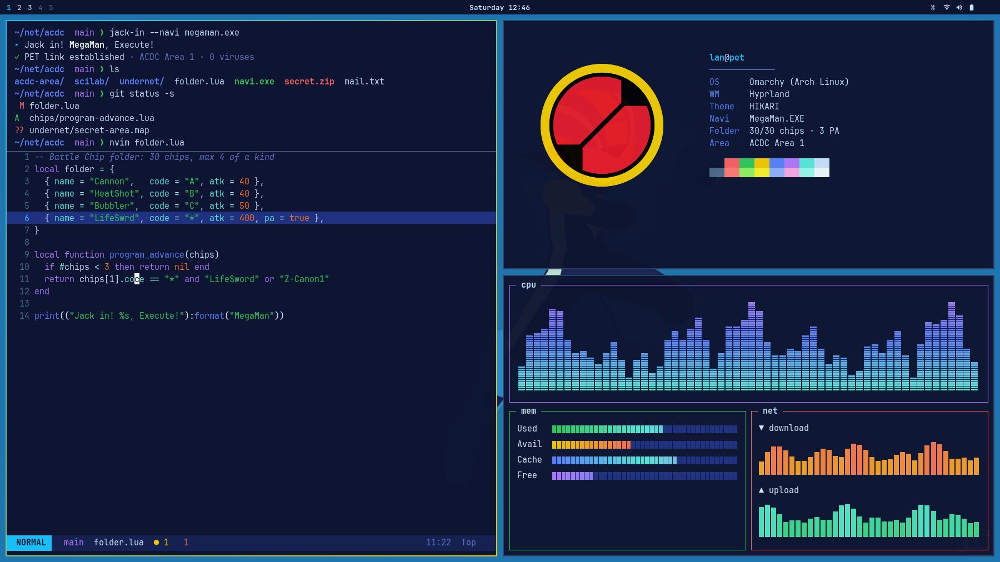

# HIKARI

A Mega Man Battle Network / Rockman.EXE theme for [Omarchy](https://omarchy.org),
named after the Hikari family (Lan, Dr. Yuichiro and Dr. Tadashi Hikari).



The desktop is styled as the Net seen through Lan's PET:
- **Background:** cyberworld navy.
- **Accent:** MegaMan.EXE's armor blue.
- **Window borders:** a gradient from his armor blue to his helmet gold.
- **Terminal colors:** battle panels, chip elements and Navi programs.

Every color was measured from game pixels or Capcom's official art.

## Install

```bash
omarchy theme install https://github.com/Balladbug/omarchy-hikari-theme
```

Or use *Install › Theme* in the Omarchy menu and paste the repo URL.

## Wallpapers

The theme ships with one wallpaper: Lucifer012's minimalist MegaMan.EXE
(CC BY 3.0).

The rest of the HIKARI set is Capcom art and fan art that isn't licensed for
redistribution, so it isn't in this repo. This script downloads it from where
it was originally published, for personal use:

```bash
~/.config/omarchy/themes/hikari/tools/fetch-wallpapers.sh
```

The script saves the wallpapers to `~/.config/omarchy/backgrounds/hikari/`,
Omarchy's per-theme folder for your own backgrounds. Cycle through them with
`omarchy theme bg next`.

How the files were prepared:
- **Upscaled:** 1080p vector art is scaled 2x with Lanczos so it stays sharp on 4K.
- **Pixel art:** scaled by whole-number factors with nearest-neighbour, so the pixels stay crisp.

| File | What | Source |
|---|---|---|
| `1-megaman-exe.png` *(included)* | MegaMan.EXE minimalist | [Lucifer012](https://www.deviantart.com/lucifer012/art/Megaman-Battle-Network-Minimalist-612967664), CC BY 3.0 |
| `01-pet-hud-dial.png` | Official HUD/emblem dial, on the theme navy | [Capcom, Legacy Collection site](https://www.capcom-games.com/megaman/exe/) |
| `02-jack-in.png` | BN5 jack-in transition frame, 16x | Capcom; rip by [Sprites INC](https://sprites-inc.com/sprite.php?local=/EXE/EXE5/Misc/MiscScreenMenu/) |
| `03-navi-emblem.png` | MegaMan Navi emblem on navy | [u/ZeroPucks](https://www.reddit.com/r/BattleNetwork/comments/9l6cud/) |
| `04-lan-and-megaman.png` | Lan & MegaMan.EXE minimalist | Oldhat104, via [u/spiral6's album](https://imgur.com/a/3d1Qi) |
| `06-bass-exe.png` | Bass.EXE minimalist | [u/DocFurry](https://www.reddit.com/r/BattleNetwork/comments/46k6lp/) |
| `07-lan-hikari.png` | Lan Hikari minimalist | [Lucifer012](https://www.deviantart.com/lucifer012/art/Lan-Hikari-%7C-Megaman-Battle-Network-Minimalist-659350921) |
| `08-roll-exe.png` | Roll.EXE minimalist | [u/DocFurry](https://www.reddit.com/r/BattleNetwork/comments/4agtsb/) |
| `09-megaman-exe-sky.png` | MegaMan.EXE minimalist (light blue) | [LimeCatMastr](https://www.deviantart.com/limecatmastr/art/Mega-Man-Battle-Network---MegaMan.exe-Wallpaper-334528356) |
| `10-protoman-exe.png` | ProtoMan.EXE minimalist | [u/DocFurry](https://www.reddit.com/r/BattleNetwork/comments/46sipi/) |
| `13-welcome-back.png` | 8-bit "Welcome Back!" jack-in pad | artist unknown; [mirror](https://wallpaperaccess.com/full/1900187.gif) |
| `14-hud-dial-split.png` | Official Vol. 1 / Vol. 2 split dial | [Capcom, Legacy Collection site](https://www.capcom-games.com/megaman/exe/) |

## Boot screen

`unlock.png` is a vector MegaMan Navi emblem. To use it on the Plymouth boot
password screen (`preview-unlock.png` shows how it looks), run:

```bash
omarchy-plymouth-set-by-theme hikari
```

This needs sudo and rebuilds the boot image.

## Claude Code theme (optional)

`claude/` holds hikari-claude, a matching theme for
[Claude Code](https://claude.com/claude-code). Installing HIKARI does not turn
it on. Run its installer when you want it:

```bash
~/.config/omarchy/themes/hikari/claude/install.sh
```

It also works on a machine without Omarchy: clone this repo anywhere and run
`claude/install.sh`. It needs only `bash` and `jq`. See
[claude/README.md](claude/README.md) for details and its palette.

## Palette

"Exact" means the value was taken from a GBA sprite or tile rip, which stores
15-bit colors, so it is the in-game value. "Snapped" means the rip had passed
through an emulator's color expansion, and each channel was reduced back to
15 bits.

| Key | Hex | Reference | Evidence |
|---|---|---|---|
| background | `#0d1430` | Net void navy: BN4 Town Area `#001038`, BN6 Central `#000050`, anime cyberworld `#10112c` | blend |
| lighter_background | `#142050` | MegaMan bodysuit navy, BN1-3 `#102858` | exact, lifted |
| selection | `#203080` | MegaMan bodysuit indigo, BN5-6 battle sprite | exact |
| muted | `#4c6a8a` | PET/HUD slate, BN4-5 HP box `#385068` | exact, lifted |
| dark_foreground | `#6070c0` | BN3 White PET menu / BN4 Custom Screen | screenshot |
| foreground | `#c8e0f8` | PET UI light text, BN3-5 HUD | screenshot |
| bright_foreground | `#f0f8f8` | PET UI white text | screenshot |
| accent | `#18c0f8` | MegaMan.EXE armor highlight, BN5-6 battle sprite | exact |
| active border | `#18c0f8` to `#f0c800` | armor blue to helmet gold, 45deg | exact |
| inactive border | `#284068` | BN6 Navi Customizer grid lines | exact |
| red | `#f86060` | player-side battle panel, BN2/BN3 | exact |
| bright_red | `#ff7974` | Legacy Collection site coral | official CSS |
| orange | `#f87020` | Lan Hikari's vest, BN6 | exact |
| yellow | `#f0c800` | helmet + Navi emblem gold (every game) | exact |
| bright_yellow | `#f8f028` | Elec element icon | exact |
| green | `#30c858` | Wood element icon | exact |
| bright_green | `#90f060` | Wood Style highlight, BN2/BN3 | exact |
| cyan | `#58e8d8` | jack-in beam, BN1-3 | snapped |
| bright_cyan | `#98f8e8` | jack-in beam, light | snapped |
| blue | `#5880f8` | Aqua element icon | exact |
| bright_blue | `#90b0f8` | Aqua Style highlight, BN2/BN3 | exact |
| magenta | `#b078f8` | Dark Chip class stamp, BN5 | exact |
| bright_magenta | `#f8a8e0` | Navi Customizer pink program, BN6 | exact |
| brown | `#804840` | Lan's hair, BN6 | exact |

Text colors on `background`, as WCAG contrast ratios:
- **Body text:** `foreground` is 13.3:1.
- **Normal and bright colors:** every one is 5:1 or higher. The lowest is `blue` at 5.05:1.
- **Dim colors:** `dark_foreground` (3.95:1) and `muted` (3.2:1) are meant to recede, like comments in a code editor.

### Palette sources

- **Sprite and tile rips:**
  - [Sprites INC](https://sprites-inc.com/files/EXE/)
  - [The Spriters Resource](https://www.spriters-resource.com/game_boy_advance/)
- **Full area maps:** [VGMaps](https://www.vgmaps.com/Atlas/GBA/)
- **Panel tiles, element icons and MegaMan form sprites:** [The Rockman EXE Zone wiki](https://www.therockmanexezone.com/wiki/)
- **Box art, screenshots, anime frames and logos:** [Mega Man Knowledge Base](https://megaman.fandom.com/)
- **Modern brand colors:** the CSS of the [official Legacy Collection site](https://www.capcom-games.com/megaman/exe/)

The measured color tables are in `tools/palette-research/`:
- Net-area backdrops and floors for BN1-6
- battle backgrounds
- battle panels by game and type
- 137 MegaMan forms, styles, souls, crosses and beasts

## Tools

| Tool | What it does |
|---|---|
| `tools/fetch-wallpapers.sh` | Downloads and builds the full wallpaper set (needs `curl` and `magick`) |
| `tools/palette_check.py` | Prints WCAG contrast for every key in a `colors.toml`, and the closest pairs of terminal colors |
| `tools/render_preview.py` | Renders `preview.png`, a mock Omarchy desktop, from a `colors.toml` |
| `tools/emblem.py` | Draws the vector Navi emblem used for `unlock.png` |
| `claude/build.py` | Rebuilds the Claude Code theme from `colors.toml` |

## Credits and licensing

- *Mega Man Battle Network*, *Rockman.EXE* and the MegaMan Navi emblem are (c) Capcom. This is an unofficial fan theme, not affiliated with or endorsed by Capcom.
- `backgrounds/1-megaman-exe.png` is "Megaman Battle Network Minimalist" by [Lucifer012](https://www.deviantart.com/lucifer012), licensed under [CC BY 3.0](https://creativecommons.org/licenses/by/3.0/). It is re-encoded and its metadata stripped; the image is otherwise unchanged.
- The wallpapers fetched by `tools/fetch-wallpapers.sh` belong to Capcom and to the artists credited above.
